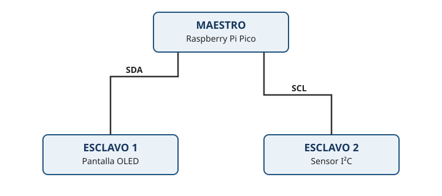
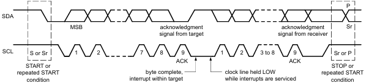
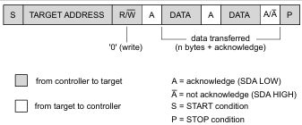

# 10_Taller_I2C_OLED
## Taller 10 — Comunicación I²C y pantalla OLED con Raspberry Pi Pico


## 1. Propósitos de aprendizaje

Al terminar el taller, el estudiante podrá:

- Explicar para qué sirve el bus I²C y reconocer sus señales principales.
- Conectar una pantalla OLED I²C a una Raspberry Pi Pico.
- Identificar la dirección I²C del dispositivo.
- Mostrar texto y valores de variables en una pantalla OLED usando MicroPython.
- Actualizar la pantalla periódicamente sin bloquear innecesariamente el programa.
- Relacionar la pantalla local con el diagnóstico del robot.
- Proponer una visualización del estado del Watchdog para la actividad final.

## 2. Materiales

- Raspberry Pi Pico o Pico W.
- Pantalla OLED I²C compatible con el controlador SSD1306, normalmente de 128 × 64 píxeles.
- Protoboard y cables.
- Cable USB.
- Computador con Thonny o un entorno compatible con MicroPython.


## 3. I²C (*Inter-Integrated Circuit*)


### 3.1 Conexión física




El I²C  es un bus de comunicación serial síncrono que permite conectar varios dispositivos usando dos líneas principales:

- **SDA (Serial Data):** transporta los datos.
- **SCL (Serial Clock):** proporciona el reloj de sincronización.

Las líneas SDA y SCL suelen requerir resistencias pull-up. En nuestro caso, estas están integradas en la Raspberry Pi Pico. 

Los dispositivos I²C también requieren conexiones de alimentación y tierra.

- **GND**
- **3.3V** (en el caso de la Raspberry Pi Pico).

> **Importante:** verifica las etiquetas de alimentación y señales de tu módulo. Muchos OLED SSD1306 funcionan con lógica de 3,3 V, pero los módulos no son todos iguales. No conectes señales de 5 V directamente a los GPIO de la Pico.

### 3.2 Protocolo I2C

[https://www.nxp.com/docs/en/user-guide/UM10204.pdf](https://www.nxp.com/docs/en/user-guide/UM10204.pdf)

En I²C, la señal SDA transporta los datos y SCL proporciona el reloj.






* **START:** SDA pasa de nivel alto a bajo mientras SCL está alto.
* **STOP:** SDA pasa de nivel bajo a alto mientras SCL está alto.

Durante la transmisión normal de bits, SDA debe mantenerse estable mientras SCL está alto; los datos suelen cambiar cuando SCL está bajo.

El primer byte de una transacción I²C de 7 bits se forma así:

```text
  7 bits de dirección   R/W
  +-------------------+---+
  | A6 A5 A4 A3 A2 A1 A0 | R/W |
  +-------------------+---+
```

* `R/W = 0`: escritura.
* `R/W = 1`: lectura.

Por tanto, el byte transmitido depende de la dirección y de la operación solicitada.

### 3.3 Dos tipos de direcciones

* **Dirección del dispositivo**:  Dirección del dispositivo: identifica el dispositivo con el que se desea comunicar. 
* *Dirección interna de registros**: Identifica un registro o posición dentro del dispositivo, si el protocolo del dispositivo lo permite.

### 3.4 Periféricos I²C y sus direcciones

| Periférico    | Dirección primaria | Rango de direcciones secundarias                                           | Modo para cambiar la dirección                                                           | Comentarios                                                 |
| ------------- | ------------------ | -------------------------------------------------------------------------- | ---------------------------------------------------------------------------------------- | ----------------------------------------------------------- |
| OLED SSD1306  | `0x3C`             | `0x3D`                                                                     | Selección mediante el pin SA0 o configuración del módulo, según el diseño.               | Muy común en pantallas OLED de 128 × 64 y 128 × 32 píxeles. |
| Sensor BME280 | `0x76`             | `0x77`                                                                     | Cambiar el estado del pin SDO.                                                           | Mide temperatura, presión atmosférica y humedad.            |
| Sensor BMP280 | `0x76`             | `0x77`                                                                     | Cambiar el estado del pin SDO.                                                           | Mide temperatura y presión atmosférica.                     |
| MPU-6050      | `0x68`             | `0x69`                                                                     | Cambiar el estado del pin AD0.                                                           | Acelerómetro y giroscopio de 6 ejes.                        |
| MPU-9250      | `0x68`             | `0x69`                                                                     | Cambiar el estado del pin AD0.                                                           | IMU con acelerómetro, giroscopio y magnetómetro.            |
| VL53L0X       | `0x29`             | No dispone de un rango seleccionable mediante pines.                       | Cambiar la dirección por software mediante su API, normalmente después de inicializarlo. | Sensor de distancia por tiempo de vuelo (ToF).              |
| TCS34725      | `0x29`             | No seleccionable mediante pines en el módulo habitual.                     | Dirección fija en la configuración habitual.                                             | Sensor de color y luminosidad.                              |
| BH1750        | `0x23`             | `0x5C`                                                                     | Cambiar el estado del pin ADDR.                                                          | Sensor de luminosidad ambiental.                            |
| INA219        | `0x40`             | Hasta `0x4F`, según la configuración de A0 y A1.                           | Cambiar los puentes o niveles lógicos de A0 y A1.                                        | Medición de voltaje, corriente y potencia.                  |
| ADS1115       | `0x48`             | `0x49`–`0x4B`                                                              | Conectar el pin ADDR a GND, VDD, SDA o SCL.                                              | Convertidor analógico-digital de 16 bits.                   |
| PCF8574       | `0x20`             | `0x21`–`0x27`                                                              | Configurar los pines A0, A1 y A2.                                                        | Expansor de GPIO; frecuente en adaptadores I²C para LCD.    |
| PCF8574A      | `0x38`             | `0x39`–`0x3F`                                                              | Configurar los pines A0, A1 y A2.                                                        | Variante del PCF8574 con otro bloque de direcciones.        |
| DS3231        | `0x68`             | Sin direcciones alternativas seleccionables en el funcionamiento habitual. | Dirección fija.                                                                          | Reloj de tiempo real (RTC).                                 |
| AT24C32       | `0x50`             | Habitualmente `0x51`–`0x57`, según el modelo y los pines de dirección.     | Configurar los pines A0, A1 y A2.                                                        | Memoria EEPROM; algunos módulos RTC incorporan una.         |
| MCP23017      | `0x20`             | `0x21`–`0x27`                                                              | Configurar los pines A0, A1 y A2.                                                        | Expansor de 16 GPIO.                                        |
| OV7670 | `0x21`                      | No dispone de una dirección alternativa seleccionable mediante pines en el funcionamiento habitual. |  Dirección fija | Cámara VGA. Utiliza SCCB para configurar sus registros. La imagen se transmite mediante señales paralelas, no por el bus SCCB. |


---
### 3.5 MicroPython cuenta con la clase I²C

https://docs.micropython.org/en/latest/library/machine.I2C.htm

MicroPython cuanta con a librería `I2C` para comunicarse con los dispositivos. A continuación, se muestra un ejemplo de uso. Sin embargo, en nuestro caso no la usaremos, ya que los dispositivos que utilizaremos también cuentan con sus propias bibliotecas específicas.

```python
from machine import I2C

# create I2C peripheral at frequency of 400kHz
# depending on the port, extra parameters may be required
# to select the peripheral and/or pins to use
i2c = I2C(freq=400000)

# scan for peripherals, returning a list of 7-bit addresses
i2c.scan()                      

# write 3 bytes to peripheral with 7-bit address 42
i2c.writeto(42, b'123')         

# read 4 bytes from peripheral with 7-bit address 42
i2c.readfrom(42, 4)             

# read 3 bytes from memory of peripheral 42,
#   starting at memory-address 8 in the peripheral
i2c.readfrom_mem(42, 8, 3)      

# write 1 byte to memory of peripheral 42
#   starting at address 2 in the peripheral
i2c.writeto_mem(42, 2, b'\x10')
```


## 4 Pantalla OLED - I2C 


Una pantalla OLED genera luz mediante píxeles orgánicos emisores de luz. En el módulo SSD1306, el microcontrolador envía comandos y datos a través de I²C para controlar los píxeles. La biblioteca `ssd1306.py` ofrece funciones sencillas para escribir texto, dibujar y actualizar la imagen.

### 4.1 ¿Por qué usar una OLED en el carro-robot?

Una pantalla local puede mostrar información útil sin depender de una conexión Wi-Fi o de un dashboard:

- Estado de arranque.
- Dirección IP o estado de conexión.
- Lecturas de sensores.
- Estado de batería, si se dispone de un circuito de medición adecuado.
- Estado del programa y mensajes de diagnóstico.
- Estado del Watchdog.


### 4.2 Conexión del hardware


| OLED | | Función |
|---|---|---|
| VCC | Alimentación, 3V3(OUT) de la Pico | 
| GND | GND de la Pico |
| SDA |  Datos I²C |
| SCL |  Reloj I²C |


### 4.3 Driver de la OLED - I2C
https://docs.micropython.org/en/latest/esp8266/tutorial/ssd1306.htm


Para controlar la pantalla OLED, utilizaremos el controlador de software `ssd1306.py`. Para utilizar este driver hay que descargar este archivo en la Raspberry Pi Pico

https://github.com/micropython/micropython-lib/blob/master/micropython/drivers/display/ssd1306/ssd1306.py

A continuación se presenta un ejemplo de uso. La dirección más habitual en estos módulos es 0x3C, aunque algunos utilizan 0x3D. Por eso, es recomendable comprobar la dirección mediante un escaneo del bus antes de inicializar la pantalla.

```python
from machine import Pin, I2C
import ssd1306

# using default address 0x3C
i2c = I2C(sda=Pin(26), scl=Pin(27))
display = ssd1306.SSD1306_I2C(128, 64, i2c, addr=0x3C)

# Print Hello World on the first line:
display.text('Hello, World!', 0, 0, 1)
display.show()

```


Funciones básicas:

```python
display.poweroff()     # power off the display, pixels persist in memory
display.poweron()      # power on the display, pixels redrawn
display.contrast(0)    # dim
display.contrast(255)  # bright
display.invert(1)      # display inverted
display.invert(0)      # display normal
display.rotate(True)   # rotate 180 degrees
display.rotate(False)  # rotate 0 degrees
display.show()         # write the contents of the FrameBuffer to display memory
```


La clase FrameBuffer provee soporte para gráficas:

```python
display.fill(0)                         # fill entire screen with colour=0
display.pixel(0, 10)                    # get pixel at x=0, y=10
display.pixel(0, 10, 1)                 # set pixel at x=0, y=10 to colour=1
display.hline(0, 8, 4, 1)               # draw horizontal line x=0, y=8, width=4, colour=1
display.vline(0, 8, 4, 1)               # draw vertical line x=0, y=8, height=4, colour=1
display.line(0, 0, 127, 63, 1)          # draw a line from 0,0 to 127,63
display.rect(10, 10, 107, 43, 1)        # draw a rectangle outline 10,10 to 117,53, colour=1
display.fill_rect(10, 10, 107, 43, 1)   # draw a solid rectangle 10,10 to 117,53, colour=1
display.text('Hello World', 0, 0, 1)    # draw some text at x=0, y=0, colour=1
display.scroll(20, 0)                   # scroll 20 pixels to the right

# draw another FrameBuffer on top of the current one at the given coordinates
import framebuf
fbuf = framebuf.FrameBuffer(bytearray(8 * 8 * 1), 8, 8, framebuf.MONO_VLSB)
fbuf.line(0, 0, 7, 7, 1)
display.blit(fbuf, 10, 10, 0)           # draw on top at x=10, y=10, key=0
display.show()
```

Dibujando el logo de MicroPython:

```python
display.fill(0)
display.fill_rect(0, 0, 32, 32, 1)
display.fill_rect(2, 2, 28, 28, 0)
display.vline(9, 8, 22, 1)
display.vline(16, 2, 22, 1)
display.vline(23, 8, 22, 1)
display.fill_rect(26, 24, 2, 4, 1)
display.text('MicroPython', 40, 0, 1)
display.text('SSD1306', 40, 12, 1)
display.text('OLED 128x64', 40, 24, 1)
display.show()
```


## 5. Actividad 

Crea una clase llamada `OLED` que se suscriba al tópico `oled/text` y permita escribir texto en la pantalla OLED utilizando los argumentos correspondientes.

