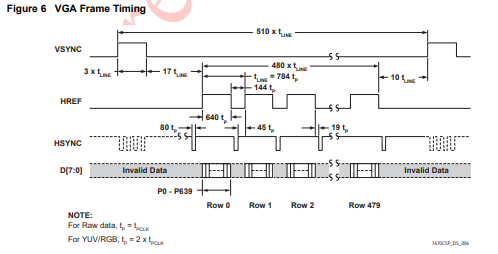
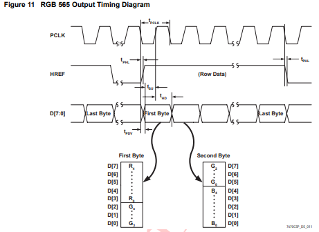

# Workshop 11. Computer vision: image acquisition and transmission with Raspberry Pi Pico W and OV7670

## Learning objectives

By the end of this workshop, students should be able to:

- Identify the main characteristics and interfaces of the OV7670 camera.
- Explore how the Raspberry Pi Pico W configures and captures an image.
- Understand the role of SCCB, XCLK, PCLK, HREF, VSYNC and the parallel data bus.
- Use the publish/subscribe communication model and the role of MQTT.
- Interpret an RGB565 image buffer and describe how it can be displayed in a web dashboard.


## 11.1. Introduction to Digital Imaging and the OV7670

The OV7670 is a CMOS image sensor with the following main characteristics:

- **Maximum resolution:** VGA (640 × 480 pixels).
- **Colour formats:** RGB (including RGB565), YUV and other supported formats.
- **Frame rate:** Up to 30 frames per second (depending on resolution, configuration and operating conditions).

### Image size

When using RGB565, each pixel requires 16 bits (2 bytes). Therefore, a full VGA image requires:

$
640 \times 480 \times 2 = 614,400 \text{ bytes}
$

This is approximately 600 KB of memory per frame.

### Image scaling

The OV7670 also supports smaller image sizes through its scaling configuration:

| Configuration | Image dimensions | Pixels |
|---|---:|---:|
| Full resolution | 640 × 480 | 307,200 |
| DIV2 | 320 × 240 | 76,800 |
| DIV4 | 160 × 120 | 19,200 |
| DIV8 | 80 × 60 | 4,800 |
| DIV16 | 40 × 30 | 1,200 |

Reducing the image dimensions decreases memory requirements and the amount of data that must be transmitted.

For example, using DIV4 (160 × 120) with RGB565 requires only:

$
160 \times 120 \times 2 = 38,400 \text{ bytes}
$


## 11.2. OV7670 architecture and communication interfaces

The OV7670 uses different signals for configuration and image acquisition:


- SCCB interface for configuring the camera registers.
- XCLK: external clock supplied to the camera.
- PCLK: pixel clock used to time the image data.
- VSYNC: frame synchronization.
- HREF: line or row synchronization.
- D0–D7: parallel image data bus.
- Relationship between synchronization signals and pixel capture.

The SCCB (I2C) interface is used to configure the OV7670 by reading and writing its internal registers. Once configured, the camera transfers pixel data to the Raspberry Pi Pico through its 8-bit parallel data interface.








## 11.3. Connecting the OV7670 to the Raspberry Pi Pico W


The pin assignment used in the example program for this image is:

| OV7670 signal | Pico W GPIO | Purpose |
|---|---:|---|
| PWDN / SHUTDOWN | GP0 | Camera power-down | 
| RESET | GP1 | Camera reset |
| D0–D7 | GP2–GP9 | Parallel image data |
|XCLK / MCLK | GP10 | Clock generated by the Pico W |
| PCLK | GP11 | Pixel clock input |
| HREF | GP12 | Line synchronization |
| VSYNC | GP13 | Frame synchronization |
| SDA | GP14 | SCCB data (I2C-SDA1) |
| SCL | GP15 | SCCB clock (I2C-SCL1)|

> Verify the pinout and electrical requirements of the specific OV7670 module being used. Module boards may differ in pin labels and power circuitry.

The GPIO pin assignments are defined in the `config_gpio.py` file:

```python
OV7670_GPIOs={
    'shutdown' : 0,
    'reset'    : 1,
    'data_0'   : 2,   # D0-D7: GP2 a GP9
    'mclk'     : 10,
    'pclk'     : 11,
    'href'     : 12,
    'vsync'    : 13,
    'sda1'     : 14, #SDA1
    'scl1'     : 15  #SCL1    
    }
SDA1_GPIO=OV7670_GPIOs['sda1']
SCL1_GPIO=OV7670_GPIOs['scl1']
```

The data_0 parameter specifies the first GPIO pin used for the camera's 8-bit parallel data bus. The remaining data pins are assigned to consecutive GPIOs, from GP2 to GP9.

## 11.4. Camera configuration and image capture with MicroPython

The camera software is organized into three main files:

* `drivers/ov7670.py` contains low-level routines. In particular, it configures the PIO to access the camera's data pins (D0-D7). The driver specifies only the first data pin; the other seven pins must be consecutive GPIOs in the same order. Therefore, the data pin order cannot be freely rearranged.

* `drivers/ov7670_wrapper.py` provides higher-level routines for camera configuration. For example, wrapper_configure_rgb() configures the camera to use the RGB565 colour format.

* `drivers/camera.py` provides an interface to use the camera as a PubSub node.


The following example initializes the I2C interface and the camera:


```python
print("Inicializando I2C y OV7670...")

pins=config_gpio.OV7670_GPIOs

i2c1 = I2C(
        1, 
        freq=400_000, 
        scl=Pin(pins['scl1']), 
        sda=Pin(pins['sda1'])
)

camera=Camera(
        pins=pins, 
        i2c=i2c1, 
        scheduler=scheduler, 
        pubsub=node, 
        period_ms=1000, test=OV7670_TEST_PATTERN_COLOR_BAR)
```

**Testing the camera**

Since image data is transmitted over the Internet, it is recommended to use the camera's built-in test pattern when testing the communication system. This allows you to verify image acquisition and transmission without relying on a real camera scene.

To disable the test pattern and capture images from the sensor, change:

`test=OV7670_TEST_PATTERN_COLOR_BAR` 

to 

`test=OV7670_TEST_PATTERN_NONE`

**Image resolution**

The image resolution is configured using the following function:

`width, height = self.ov7670.wrapper_configure_size(SIZE_DIV)` 

The `SIZE_DIV` parameter selects the image dimensions::

```python
OV7670_SIZE_DIV1  = 0 # 640x480
OV7670_SIZE_DIV2  = 1 # 320x240
OV7670_SIZE_DIV4  = 2 # 160x120
OV7670_SIZE_DIV8  = 3 # 80x60
OV7670_SIZE_DIV16 = 4 # 40x30
```

**RGB565 image format**

The example uses a 160 × 120 image and RGB565 encoding. RGB565 stores each pixel in 16 bits: 5 bits for red, 6 bits for green and 5 bits for blue.

For a 160 × 120 frame:

- Number of pixels: 19,200.
- Bytes per pixel: 2.
- Frame buffer size: 38,400 bytes.

The frame buffer size is calculated as:

$
\text{Buffer size} = \text{width} \times \text{height} \times 2
$

Reducing the resolution decreases the amount of memory required and the volume of data transmitted over the network.

## 11.5. MQTT and publish/subscribe communication for image data

The MQTT topic includes the image resolution and colour format. For example:

```text
camera/frame/rgb565_640x480
camera/frame/rgb565_320x240
camera/frame/rgb565_160x120
camera/frame/rgb565_80x60
camera/frame/rgb565_40x30
```

A subscriber can receive image frames from any of these resolutions by subscribing to:

```text
camera/frame/+
```

The `+` wildcard matches exactly one topic level. In this case, it matches the different resolution and format identifiers after `camera/frame/`.

**Image payload**

The MQTT payload contains the image data encoded in the same format used by the camera. In our example, the image is transmitted using RGB565.

Each pixel occupies 16 bits (2 bytes), with 5 bits for red, 6 bits for green, and 5 bits for blue.

The subscriber must know the image dimensions and encoding format to reconstruct and display the image correctly.


## 11.6. Image Reconstruction and Visualization in a Web Dashboard

The following code, from the `PubSub_client_web.html` file, shows how an incoming RGB565 image is converted into a format that can be displayed by an HTML Canvas.

First, the subscriber listens for messages on the `camera/frame/+` topic. The image resolution is extracted from the topic name.

```javascript
bus.sub_pre("camera/frame/+", (topic, payload) => {
    // Extract image resolution from the topic
    const match = topic.match(/rgb565_(\d+)x(\d+)$/);

    if (!match) {
        console.error("Invalid camera topic:", topic);
        return;
    }

    const W = parseInt(match[1]);
    const H = parseInt(match[2]);

    // Convert the payload into a Uint8Array
    const u8 = payload instanceof Uint8Array
        ? payload
        : new Uint8Array(payload);

    // Check the received frame size
    if (u8.length !== W * H * 2) {
        console.error("Invalid frame size:", u8.length);
        return;
    }

    // Create an RGBA image buffer
    const img = ctx.createImageData(W, H);
    const data = img.data;

    // Convert RGB565 pixels into RGBA pixels
    for (let i = 0; i < u8.length; i += 2) {
        const rgb565 = (u8[i] << 8) | u8[i + 1];

        const r = ((rgb565 >> 11) & 0x1F) << 3;
        const g = ((rgb565 >> 5) & 0x3F) << 2;
        const b = (rgb565 & 0x1F) << 3;

        const idx = (i >> 1) * 4;

        data[idx]     = r;
        data[idx + 1] = g;
        data[idx + 2] = b;
        data[idx + 3] = 255;
    }

    // Adapt the canvas to the received frame resolution
    canvas.width = W;
    canvas.height = H;

    // Display the reconstructed image
    ctx.putImageData(img, 0, 0);

    camInfo.textContent = `RGB565 ${W}x${H} | ${u8.length} bytes`;
});
```

### Understanding the conversion

The camera sends each pixel using 16 bits (2 bytes) in RGB565 format. However, the HTML Canvas `ImageData` object expects four 8-bit components per pixel: red, green, blue, and alpha (RGBA).

The conversion involves three steps:

1. **Reconstruct the RGB565 value:** Combine two consecutive bytes into a 16-bit value.
2. **Extract the colour components:** Recover the 5-bit red, 6-bit green, and 5-bit blue values.
3. **Build the RGBA pixel:** Store the three colour components and set the alpha channel to 255 (fully opaque).

The resulting RGBA image is then displayed using `ctx.putImageData()`.

This process allows the browser to reconstruct and visualize the image received from the camera without requiring an image file format such as JPEG or PNG.

