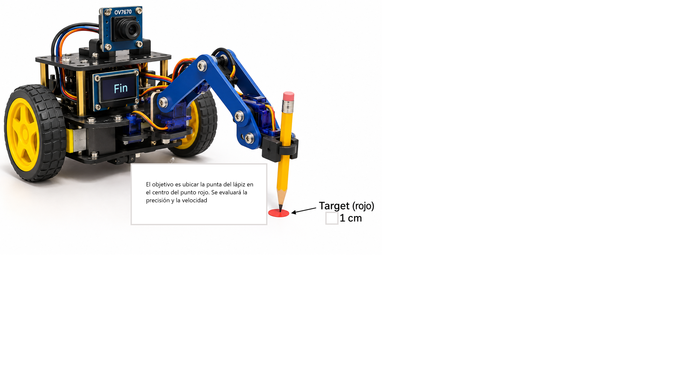

# Búsqueda y manipulación autónoma de un objetivo

## Misión

El CarroBot deberá: 
* encontrar un objetivo (de color rojo de 1cm de diámetro ubicado en el suelo a 10 cm de la posición inicial), 
* desplazarse autónomamente hasta él y 
* posicionar con su brazo robótico la punta de un lápiz sobre el objetivo.

Para cumplir la misión, el robot utilizará la cámara OV7670 para
observar el entorno, identificar el color objetivo y tomar decisiones
sobre sus movimientos.

**La misión debe realizarse sin control remoto ni intervención humana
durante su ejecución.**

## Criterios de evaluación

  Criterio                                        Puntos
  -------------------------------------------- ---------
  Velocidad                                           50
  Precisión                                           50
  **Total**                                      **100**

